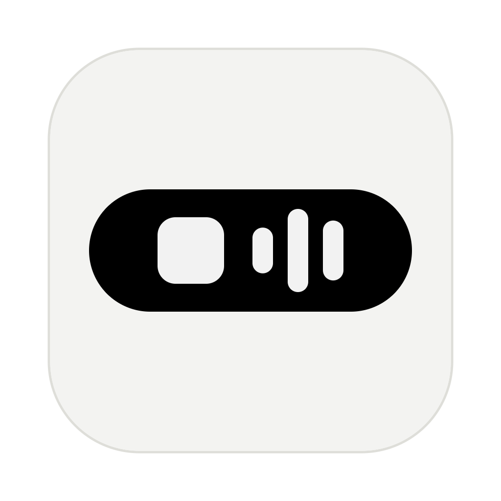

<div align="center">



# timbr

**Sound, precisely yours.** · *Som, precisamente seu.*

O timbr é um notch audiófilo para macOS que reúne mixer de áudio por aplicativo, equalizador paramétrico `Float64` e Observatório da cadeia sonora. Funciona **100% local, sem driver virtual e sem telemetria**, com código aberto sob a licença **MPL-2.0**.


[](https://github.com/v1nometrics/timbr/releases)

[Releases (beta)](https://github.com/v1nometrics/timbr/releases) · [Instalar e atualizar](docs/instalacao.md) · [Estado atual](#estado-atual-2026-11-23) · [Como compilar e testar](#build-testes-e-instala%C3%A7%C3%A3o-macos-15--apple-silicon) · [Arquitetura](#arquitetura-e-estrutura-do-c%C3%B3digo) · [Documentação](#mapa-da-documenta%C3%A7%C3%A3o) · [Contribuir](CONTRIBUTING.md)

</div>

---

## Por que o timbr existe

Apps de controle de áudio no macOS costumam cobrar caro em simplicidade ou em integridade do sinal: drivers virtuais que exigem reiniciar o `coreaudiod`, equalizadores sem proteção contra picos inter-sample, interfaces que disputam espaço na barra de menus ou silenciamentos que vazam som se o app travar.

O **timbr** parte de cinco regras de engenharia verificáveis em código:

1. **Zero driver virtual:** captura por **Core Audio Process Taps** (`CATapDescription`), sem instalar extensões HAL no sistema ([ADR-0004](docs/07-decisoes/ADR-0004-captura-por-process-taps.md)).
2. **Neutro de verdade (P1):** quando nenhum app está sendo atenuado e o EQ está desligado, o `timbr` cria **0 taps** — o áudio segue direto para o hardware.
3. **Núcleo DSP `Float64` em tempo real (C++20 + Accelerate/vDSP):** filtros biquad Vicanek/RBJ, Auto-Preamp por resposta somada, limiter True-Peak com oversampling `4×`, medição EBU R128 e FFT, com **zero alocações e zero locks** no callback RT ([ADR-0003](docs/07-decisoes/ADR-0003-nucleo-dsp.md)).
4. **Mudo à prova de falha:** um processo auxiliar isolado (`timbr-mute-keeper`) mantém silenciados os apps que você mutou (ou zerou em `0 %`) mesmo se o `timbr` fechar, travar ou sofrer `kill -9` ([ADR-0017](docs/07-decisoes/ADR-0017-mudo-a-prova-de-falha.md)).
5. **100% local e honesto (P4 / P7):** zero conta, zero nuvem, zero telemetria. Todo número no Observatório distingue o que é **medido**, **reportado** pelo sistema ou **inferido** — nada é simulado.

---

## Estado atual (2026-11-23)

O projeto está em **MVP funcional (uso diário / dogfood)** com histórico consolidado de 25 ADRs. Seguimos uma regra estrita de transparência ([`AGENTS.md`](AGENTS.md)): abaixo está separado o que já foi **comprovado** (por teste, medição ou captura real) do que ainda **está aberto ou não existe**.

### O que funciona hoje (comprovado)

| Área | Estado | Evidência verificada |
|---|---|---|
| **Volume e mudo por app** | Funciona | Autoteste E2E no app instalado: 50 / 25 / 200 / 150 % medem −6,02 / −12,04 / +6,02 / +3,52 dB; mudo = silêncio ([registro E2E](docs/08-registro/teste-e2e-volume-por-app-2026-11-22.md)) |
| **Mudo à prova de falha** | Funciona | `timbr-mute-keeper` ([ADR-0017](docs/07-decisoes/ADR-0017-mudo-a-prova-de-falha.md)); `scripts/selftest_mute_persistence.sh` (5/5) + teste auditivo com `kill -9` |
| **Detecção de fontes simultâneas** | Funciona | Orientado a eventos do Core Audio (`AudioProcessMonitor`); atribuição de helpers e serviços do macOS nomeados ("Sons do sistema", "Siri e Ditado"…) |
| **Motor EQ `Float64` + True-Peak Limiter** | Funciona | C++20 + `vDSP` testado com ASan/UBSan no CI; limiter segura −0,30 dBFS no autoteste; separação **Correção × Gosto** ([ADR-0010](docs/07-decisoes/ADR-0010-correcao-e-gosto.md)) |
| **Equalizador 4 / 5 / 10 bandas + PEQ livre** | Funciona | Curva interativa sincronizada com os pontos, "Resetar filtros" com desfazer, ajuda contextual (`InfoHintButton`) e import/export EqualizerAPO ([ADR-0019](docs/07-decisoes/ADR-0019-equalizador-de-4-5-10-bandas-e-peq-livre.md)) |
| **Notch nativo (5 estados + HUD de volume e brilho)** | Funciona | Repouso, compacto, espiada, expandido e HUD; continuidade entre Spaces, ocultação inteligente em tela cheia, ícones lado a lado sem sobreposição, sem queixo indevido no Chrome; sons curtos do sistema não o acordam ([ADR-0020](docs/07-decisoes/ADR-0020-sons-do-sistema-nao-acordam-o-notch.md)) e percepção rápida de pausa com tap ativo ou modo opt-in ([ADR-0021](docs/07-decisoes/ADR-0021-notch-percebe-a-pausa-sem-esperar-o-macos.md)) |
| **Estúdio & primitivas de áudio** | Funciona | Mixer, Equalizador, Observatório, Ajustes e Sobre em modo claro/escuro acromático ([ADR-0016](docs/07-decisoes/ADR-0016-identidade-acromatica.md)); medidores `TLevelMeter`, `TLCDDisplay`, `TKnob`, `TChannelButton` e `TClipIndicator` |
| **Observatório: linha do tempo, busca e exportação** | Funciona | Paginação por cursor + busca FTS5 trigram + exportação CSV/JSON em streaming; medido com 500 mil eventos: página em ~0,1 ms e busca em 7–43 ms ([ADR-0018](docs/07-decisoes/ADR-0018-linha-do-tempo-busca-e-exportacao.md)) |
| **Tempo de escuta e volume alto (regra 60/60)** | Funciona (**sem decibéis**) | Contagem local de minutos com fone e volume ≥ 60 %, sem criar tap extra e sem simular SPL ([ADR-0023](docs/07-decisoes/ADR-0023-tempo-de-escuta-e-volume-alto.md)) |
| **Ícone de barra de menus condicional** | Funciona | Aparece apenas quando o notch não é a entrada ativa (display sem notch, notch desligado ou preferência explícita — [ADR-0013](docs/07-decisoes/ADR-0013-superficies.md)) |
| **Feedback local por e-mail & trilinguismo (`PT / ES / EN`)** | Funciona | Abre o cliente de e-mail com prévia transparente e contexto mínimo opcional ([ADR-0024](docs/07-decisoes/ADR-0024-feedback-por-email-local.md)); paridade PT/ES/EN verificada no CI |
| **Fail-safe & alvo Mach-O macOS 15.0** | Funciona | 20× `kill -9` sem agregados órfãos e saída padrão restaurada no CI; binários `Timbr` e `timbr-mute-keeper` verificados em `macosx15.0` (`check_deployment_target.py`) |

### Limitações honestas e próximos passos

| Item | Estado atual | Referência |
|---|---|---|
| **Recuperação pós-reset do `coreaudiod`, sleep/wake e readback do keeper** | **Em aberto (prioridade)** | [Auditoria de resiliência (RES-02/03/04)](docs/08-registro/auditoria-resiliencia-2026-11-23.md) |
| **Roteamento de cada app para uma saída diferente (`RF-0201`)** | **Não implementado** | Maior lacuna funcional do mixer ([Roadmap](docs/06-plano/roadmap-e-backlog.md)) |
| **Now Playing, letras (LRCLIB), ShazamKit e cenas automáticas** | **Não implementado** | Planejado para Fase 2 ([PRD](docs/02-produto/PRD.md)) |
| **Notarização Apple Developer ID e Sparkle 2** | **Parcial (updates via GitHub Releases ativos)** | Verificação via GitHub Releases e troca automática quando a assinatura é compatível ([ADR-0026](docs/07-decisoes/ADR-0026-atualizacoes-github-releases.md)); notarização depende de conta Apple Developer |
| **Bancada física com Momentum 4 / AirPods (`E-08`, `E-09`) e macOS 15 real** | **Não executada** | Código de leitura existe; binário fixado em `15.0`, ainda sem ensaio em máquina com macOS 15 |
| **Consumo em repouso, latência em loopback e MacBook Pro OLED** | **Não medido / Desconhecido** | [Plano de Experimentos](docs/06-plano/plano-de-experimentos.md) |

Compatibilidade documentada com apps de terceiros: [superwhisper e Google Chrome](docs/08-registro/compatibilidade-apps-2026-11-22.md).

---

## Instalação rápida

O timbr roda em Macs com Apple Silicon e macOS 15 ou mais recente. O instalador público assinado e notarizado ainda está em preparação; os DMGs publicados na página de [pré-releases beta](https://github.com/v1nometrics/timbr/releases) são builds automáticas de desenvolvimento a partir da `main`.

Para instalar e entender quais recursos usam permissões do macOS, veja o [guia de instalação e atualização](docs/instalacao.md).

### Instalar pelo código-fonte

Em um Mac com **Apple Silicon e macOS 15 ou mais novo**, instale as [Command Line Tools da Apple](https://developer.apple.com/xcode/resources/) e execute no Terminal:

```bash
git clone https://github.com/v1nometrics/timbr.git && cd timbr && ./scripts/setup_dev_signing.sh && ./scripts/install_local.sh
```

O comando compila o app, instala em `/Applications/Timbr.app` e abre o timbr. Na primeira execução, conceda **Gravação de áudio do sistema** para volume por app e EQ, e **Acessibilidade** para as teclas de volume e brilho.

---

## Build, Testes e Instalação (macOS 15+ · Apple Silicon)

**Requisitos:** Mac Apple Silicon, macOS 15 ou mais novo (APIs de macOS 26 ativadas por disponibilidade) e Command Line Tools da Apple (Xcode é opcional).

> **Sobre o build:** os scripts em `scripts/` compilam todos os módulos diretamente com `clang++` + `swiftc` para funcionar com Command Line Tools puras (sem depender do Xcode completo), enquanto [`Package.swift`](Package.swift) permanece sincronizado para quem prefere abrir o projeto no Xcode ou via SwiftPM.
>
> **Paridade de CI:** o GitHub Actions (`macos-15`, Xcode 16.4) valida com **Swift 6.1** (mais rígido em isolamento de concorrência que o Swift 6.3). Sempre aguarde o check verde no PR antes de mesclar.

```bash
# 1. Clonar o repositório
git clone https://github.com/v1nometrics/timbr.git && cd timbr

# 2. (Uma vez por máquina) Criar identidade de assinatura local estável.
#    Necessária para que a permissão de Acessibilidade (teclas de volume/brilho
#    no notch e leitura da barra de menus) sobreviva entre recompilações.
./scripts/setup_dev_signing.sh

# 3. Rodar a verificação completa (tokens, extensões, zero-GPL, guardrails de design,
#    build completo + alvo macOS 15.0, C++ DSP com ASan/UBSan, Swift Core/Engine/Tokens,
#    smoke launch e 20x SIGKILL fail-safe):
./scripts/ci_check.sh

# 4. Compilar, instalar em /Applications/Timbr.app e abrir:
./scripts/install_local.sh
```

### Scripts de verificação adicionais

```bash
# Autoteste E2E de volume por app no app instalado (emite bipes de teste por ~30 s):
./scripts/selftest_audio.sh

# Prova automatizada da mecânica de mudo à prova de falha (ADR-0017):
./scripts/selftest_mute_persistence.sh

# Gerar instalador distribuível dist/Timbr.dmg:
./scripts/build_dmg.sh

# Regenerar tokens Swift + CSS a partir da fonte única JSON (ADR-0012):
python3 design-system/scripts/generate_tokens.py

# Abrir o Playground interativo do Design System:
open design-system/playground/index.html
```

### Flags de revisão visual

Para inspecionar qualquer superfície sem alterar o áudio real do sistema:

```bash
./dist/Timbr.app/Contents/MacOS/Timbr --studio mixer|equalizer|observatory|settings|support
./dist/Timbr.app/Contents/MacOS/Timbr --notch compact|peek|expanded|hud [--review-empty|--review-multi]
./dist/Timbr.app/Contents/MacOS/Timbr --panel-preview      # painel da barra de menus em janela dedicada
./dist/Timbr.app/Contents/MacOS/Timbr --onboarding
./dist/Timbr.app/Contents/MacOS/Timbr --demo               # coreografia completa do notch
./dist/Timbr.app/Contents/MacOS/Timbr --reduce-motion      # força o modo "Reduzir movimento"
```

---

## Arquitetura e Estrutura do Código

```text
timbr/
├─ Sources/
│  ├─ CTimbreDSP/          # Núcleo DSP Float64 (C++20 + Accelerate/vDSP, C ABI, zero-alloc RT)
│  ├─ TimbreCore/          # Modelos, EqualizerAPO, i18n PT/ES/EN, Guardião (G-01..G-07),
│  │                       # SQLite + FTS5 trigram, tempo de escuta 60/60, FeedbackComposer,
│  │                       # PersistentMutePolicy, AutoEq, IA local tipada, IPC loopback
│  ├─ TimbreEngine/        # Core Audio HAL + snapshot P3, ProcessTapEngine, AudioProcessMonitor,
│  │                       # AudioProcessAttribution, MuteKeeperClient, AudioSelfTest,
│  │                       # MediaKeyTap, DisplayBrightness, drivers M4 (GAIA v3) e linha Apple
│  ├─ TimbrMuteKeeper/     # Binário auxiliar independente para mudo à prova de falha (ADR-0017)
│  └─ TimbreApp/           # App nativo SwiftUI + AppKit: NotchOverlay, NotchSpaceOverlay,
│                          # FullscreenEvaluator, MenuBarPanel, StudioWindow, Onboarding, DSComponents
├─ design-system/          # Tokens fonte única (JSON → TimbreTokens.swift & tokens.css) + Playground
├─ extensions/             # Extensões MV3 (Chrome e Safari) para controle por aba via IPC local
├─ Resources/              # Marca canônica SVG/PNG (ADR-0025), Timbr.icns e template de menu
├─ Packaging/              # Homebrew cask (macOS >= :sequoia) e guia de empacotamento
├─ Tests/                  # CTimbreDSPTests (ASan/UBSan), TimbreCoreTests, TimbreEngineTests, TimbreTokensTests
├─ scripts/                # CI, build, assinatura local, DMG, fail-safe, autotestes de áudio/mudo
└─ docs/                   # Engenharia, produto, design system, ADRs (0001–0025) e registros
```

---

## Mapa da Documentação

| Pasta | Conteúdo | Documentos principais |
|---|---|---|
| **00 · Pesquisa** | Evidência técnica de Fase 1 e Fase 2 (Core Audio, DSP, Bluetooth, 62+ repos OSS, resiliência) | [Relatório Fase 1](docs/00-pesquisa/relatorio-fase-1-notch-audiofilo.md) · [Notas Fase 1](docs/00-pesquisa/notas-fase-1/) · [Notas Fase 2](docs/00-pesquisa/notas-fase-2/) · [Snapshot de Resiliência](docs/00-pesquisa/resiliencia-2026-11-23/README.md) |
| **01 · Visão** | Princípios de produto e vocabulário controlado | [Visão e Princípios](docs/01-visao/visao-e-principios.md) · [Glossário Técnico](docs/01-visao/glossario-tecnico.md) |
| **02 · Produto** | Requisitos (`EP-01`–`EP-15`), superfícies e diferenciação | [PRD](docs/02-produto/PRD.md) · [Especificação Funcional](docs/02-produto/especificacao-funcional.md) · [Mercado & Diferenciação](docs/02-produto/mercado-e-diferenciacao.md) |
| **03 · Viabilidade** | Matriz de viabilidade e laboratórios Bluetooth | [Matriz de Viabilidade](docs/03-viabilidade/matriz-de-viabilidade.md) · [Laboratório Momentum 4](docs/03-viabilidade/momentum4-laboratorio.md) · [Laboratório AirPods](docs/03-viabilidade/airpods-laboratorio.md) |
| **04 · Engenharia** | Arquitetura, DSP `Float64`, abas, Observatório, IA, segurança e RNFs | [Arquitetura Geral](docs/04-engenharia/arquitetura-geral.md) · [Motor DSP](docs/04-engenharia/motor-dsp-e-precisao.md) · [Roteamento & Abas](docs/04-engenharia/roteamento-e-abas.md) · [Observatório & Guardião](docs/04-engenharia/observatorio-e-guardiao.md) · [Inteligência & A/B](docs/04-engenharia/inteligencia-e-personalizacao.md) · [Segurança & Distribuição](docs/04-engenharia/seguranca-privacidade-distribuicao.md) · [RNFs](docs/04-engenharia/requisitos-nao-funcionais.md) |
| **05 · Design System** | Sistema acromático editorial, tokens JSON, motion nativo e primitivas `audiocn` | [Bíblia do Design System](docs/05-design-system/00-biblia-do-design-system.md) · [Fundações & Tokens](docs/05-design-system/01-fundacoes-tokens.md) · [Motion & Física](docs/05-design-system/02-motion-e-fisica.md) · [Superfícies](docs/05-design-system/03-superficies-e-anatomia.md) · [Componentes Áudio](docs/05-design-system/04-componentes-e-visualizacao-audio.md) · [Assets & Refs](docs/05-design-system/05-assets-iconografia-e-referencias.md) |
| **06 · Plano** | Experimentos (`E-01`–`E-17`), roadmap, testes objetivos e aceite | [Experimentos](docs/06-plano/plano-de-experimentos.md) · [Roadmap & Backlog](docs/06-plano/roadmap-e-backlog.md) · [Estratégia de Testes](docs/06-plano/estrategia-de-testes.md) · [Critérios de Aceitação](docs/06-plano/criterios-de-aceitacao.md) |
| **07 · Decisões** | Architecture Decision Records | [Índice de ADRs (`ADR-0001`–`ADR-0025`)](docs/07-decisoes/README.md) |
| **08 · Registro** | Progresso, E2E, compatibilidade, hipóteses, riscos e auditorias | [Progresso](docs/08-registro/progresso.md) · [E2E Volume por App](docs/08-registro/teste-e2e-volume-por-app-2026-11-22.md) · [Compatibilidade](docs/08-registro/compatibilidade-apps-2026-11-22.md) · [Auditoria de Animações](docs/08-registro/auditoria-animacoes-2026-11-23.md) · [Auditoria de Resiliência](docs/08-registro/auditoria-resiliencia-2026-11-23.md) · [Hipóteses](docs/08-registro/hipoteses.md) · [Descobertas](docs/08-registro/descobertas.md) · [Riscos](docs/08-registro/riscos-e-mitigacoes.md) |
| **09 · Open Source** | BOM, isolamento de licenças e governança | [Inventário & BOM](docs/09-open-source/inventario-e-classificacao.md) · [Estratégia OSS](docs/09-open-source/estrategia-open-source.md) |
| **10 · Referências** | Bibliografia mestra e taxonomia de evidências | [Referências e Evidências](docs/10-referencias/referencias-e-evidencias.md) |

---

## Feedback, Contribuição e Licença

- **Feedback e sugestões:** dentro do app em **Sobre → Feedback e sugestões** (ou **Enviar feedback…** no menu do notch), que prepara um e-mail local para **vinicius@v1torres.dev** sem enviar nada automaticamente ([ADR-0024](docs/07-decisoes/ADR-0024-feedback-por-email-local.md)). Para discussões públicas ou relatos de bug, [abra uma issue](https://github.com/v1nometrics/timbr/issues/new).
- **Contribuir:** consulte [`CONTRIBUTING.md`](CONTRIBUTING.md) para regras de DCO (`git commit -s`), isolamento zero-GPL, fluxo de PR e verificações obrigatórias.
- **Licença:** software livre sob **Mozilla Public License 2.0 (`MPL-2.0`)** ([`LICENSE`](LICENSE) · atribuições em [`NOTICE`](NOTICE)).
